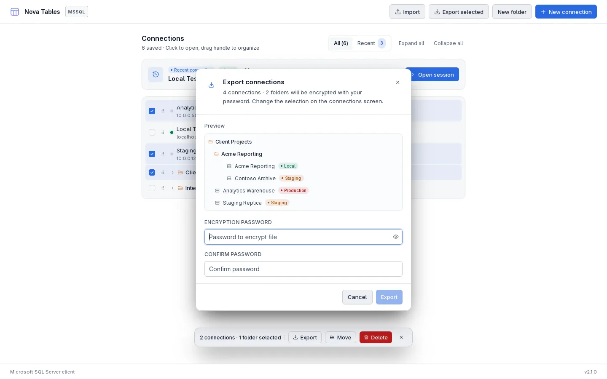
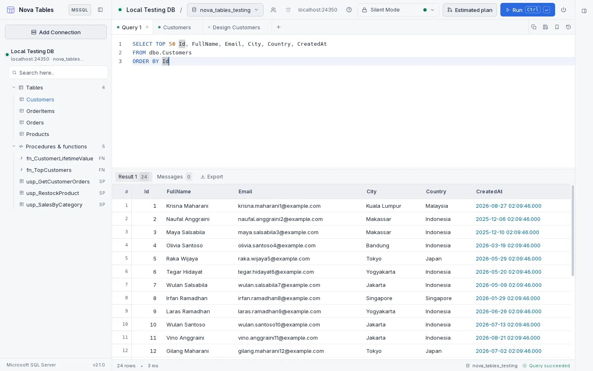
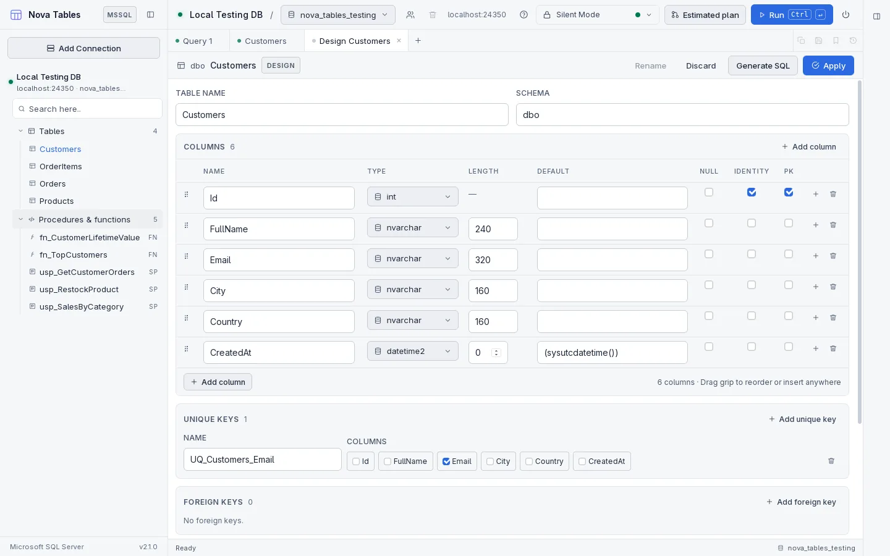
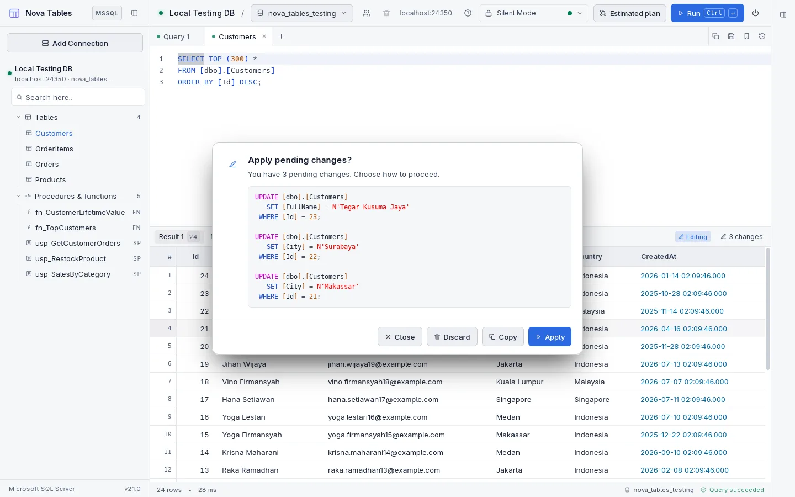
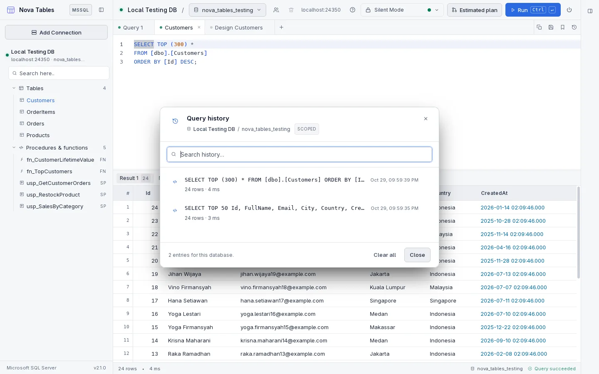

<p align="center">
  
</p>

# Nova Tables Website

Hi Future Developer,

Welcome to the official website of **Nova Tables**, a modern, high-performance desktop SQL client for **Microsoft SQL Server** built with **Tauri v2** and **Rust 2021**. This repository contains the marketing site and legal pages published at [nova-tables.novaardiansyah.id](https://nova-tables.novaardiansyah.id).

Nova Tables is made for people who work with Microsoft SQL Server every day and simply want a tidy place to look something up, write a query and read the answer. By moving from Electron to Tauri and Rust, it delivers lightweight binary sizes, lower memory consumption (~60-80MB), and instant native startup.

> **Note:** Nova Tables works with Microsoft SQL Server only. It is a local desktop application - nothing is uploaded anywhere, and neither your data nor your credentials ever leave your computer.

---

## Screenshots

Every image below is captured from Nova Tables 2.1.0 connected to a local SQL Server test database.

### Your connections, recent sessions and folders in one place

The connection screen keeps the whole tree together: a recent-connection card for one-click access, environment badges, collapsible folders and a quick connect button that jumps straight into a session.


### Export connections and their folders as one encrypted file

The export dialog previews exactly what will be written, including nested folders, before you set the passphrase.



### A calm workspace: editor above, results below

The Monaco SQL editor keeps syntax highlighting, completion and line numbers, while the resizable results grid stays in view. The header holds the database picker, execution guard, estimated plan and the run button.



### Inspect and change table structure in the table designer

Columns, lengths, defaults, nullability, identity, primary keys, unique keys and foreign keys are editable side by side, with generated DDL ready to review before it is applied.



### Edit a whole block of cells at once

Browse a table and type directly into the grid; changed cells stay highlighted, and a counter keeps track of how many edits are pending.


### Ready-to-run UPDATE statements from your edits

No edit is written silently. Reviewing changes shows the exact `UPDATE` statements generated per row, with the primary key in the `WHERE` clause, and lets you discard or apply them.



### Read a row as a JSON record

The inspect dialog formats any row or selection as JSON, with raw, wrapped and XML views for long values.


### Revisit what you ran with query history

Every execution is logged locally with row count, duration and errors, scoped to the active database and searchable.



---

## What the Website Covers

- **Landing page**: hero, feature showcase, performance and architecture notes, privacy highlights and download links for Windows and Linux.
- **Download section**: direct links to the NSIS installer, AppImage, `.deb` and `.rpm` packages published for version 2.1.0.
- **Privacy Policy**: how the desktop application handles connections, credentials, queries and local storage.
- **Terms of Service**: licensing, user responsibilities, acceptable use and liability.
- **Bilingual content**: every section is available in English and Indonesian.
- **Theme switching**: light and dark palettes that follow the same design tokens as the application.

---

## Dazzling Tech Stack

- [SvelteKit](https://svelte.dev/docs/kit) - Application framework with static prerendering
- [Svelte 5](https://svelte.dev/) - Reactive UI with runes
- [TypeScript](https://www.typescriptlang.org/) - Strict typing for content and components
- [Vite 8](https://vite.dev/) - Build tool and dev server
- [Tailwind CSS 4](https://tailwindcss.com/) - Utility-first styling with shared design tokens
- [Tauri v2](https://v2.tauri.app/) & [Rust 2021](https://www.rust-lang.org/) - The stack behind the desktop application this site presents

---

## Product Highlights

- **Connection Management**: Organize SQL Server connections with environment badges and collapsible, nested folders.
- **Recent Sessions & Quick Connect**: Jump back into recent connections with timestamp badges and dedicated quick-connect actions.
- **Encrypted Export & Import**: Password-protect your connection tree using AES-256-GCM and PBKDF2 encryption.
- **Database Navigation**: Browse databases with searchable filtering, and explore tables, views, stored procedures, and functions in a fast sidebar tree.
- **Monaco SQL Editor**: Write queries with syntax highlighting, auto-completion, line wrapping and execution guards.
- **Table Designer**: Inspect and alter table structures visually with column drag-and-drop reordering and foreign key reference pickers.
- **Interactive Results Grid**: View results with three-state column sorting, quick filtering by cell value, and foreign key link navigation.
- **In-Grid Row Editing & Deletion**: Generate verifiable `UPDATE` and `DELETE` SQL statements without silent background modifications.
- **Execution Plan Inspection**: Analyze query performance with estimated visual execution plan trees.
- **Exporting & History**: Export results to RFC 4180 CSV or formatted JSON, and review query history anytime.
- **Theme & Typography**: Switch between dark and light themes, with fonts and editor typography persisted locally.

---

## Quick Start & Development

### Prerequisites

- Node.js (v18+) & `npm`

### Development Commands

```bash
# Install frontend dependencies
npm install

# Run the development server
npm run dev

# Type-check Svelte components and TypeScript
npm run check

# Build the static site into build/
npm run build

# Preview the production build on 127.0.0.1:5937
npm run preview
```

---

## Project Structure

```text
src/
  routes/               Landing page plus privacy-policy and terms-of-service routes
  lib/components/       Header, footer, icons and the shared legal document layout
  lib/data/             Landing copy, legal documents, translations and links
  lib/stores/           Language, theme and app state
static/
  demo/                 Application screenshots used by the README and the site
```

---

## Good to Know

- The site is fully prerendered with `@sveltejs/adapter-static`; there is no server runtime.
- Language and theme preferences are stored in the browser's local storage only.
- The site loads no analytics, advertising or tracking scripts.
- Download buttons point at the release files hosted on `files.novaardiansyah.id`.
- Product source code, releases and documentation live in the [nova-tables-rust](https://github.com/novaardiansyah/nova-tables-rust) repository.

---

## Let's Connect

Need to chat? Feel free to drop me a line via [Email](mailto:admin@novaardiansyah.id) or hit me up on [WhatsApp](https://wa.me/6289506668480). I'm just a message away, ready to groove with you!

---

## Project Status


[](LICENSE)

---

## Licensing Groove

This project is grooving to the rhythm of the [MIT License](LICENSE).

Feel free to use, modify, and share it with the world. Just remember to keep the original license intact. Let's spread the joy of coding together!

---

**Happy coding and collaborating!**
- Nova Ardiansyah
