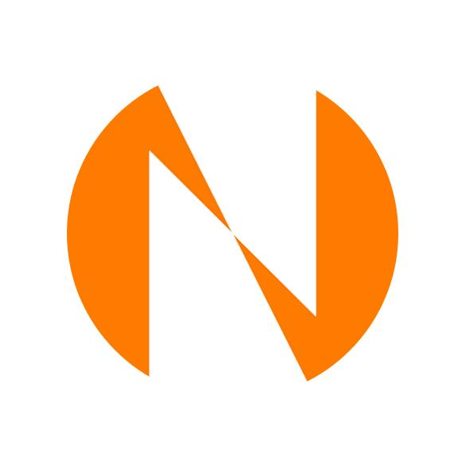
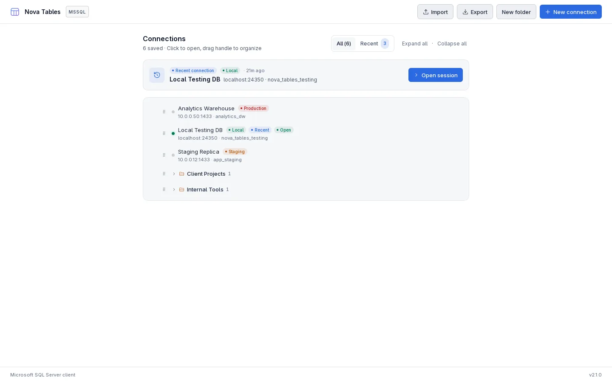
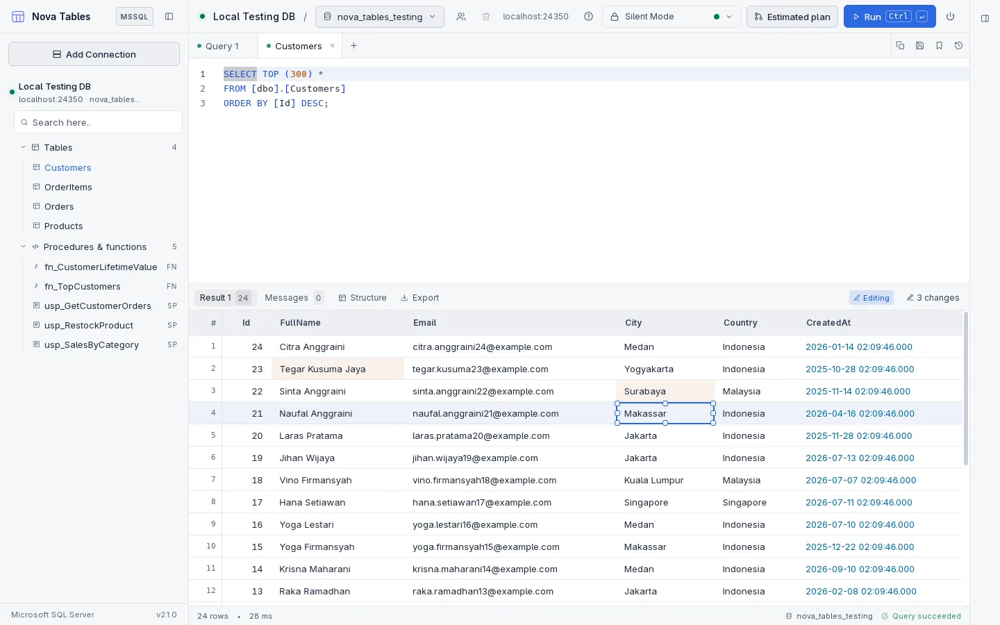
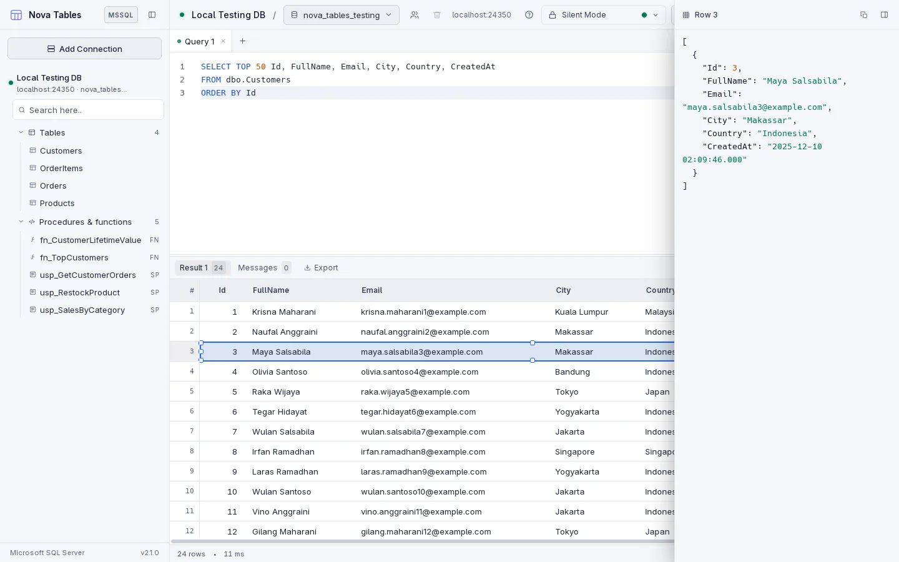

  

# Nova Tables

Hi Future Developer,

Welcome to **Nova Tables**, a modern desktop SQL client for **Microsoft SQL Server**. It brings your connections, databases, tables, queries, and results together in one calm workspace, so you can focus on the work instead of the tooling.

**Learn More**: [https://nova-tables.novaardiansyah.id](https://nova-tables.novaardiansyah.id)

Nova Tables is made for people who work with Microsoft SQL Server every day and simply want a tidy place to look something up, write a query, and read the answer. It stays deliberately small and focused on doing that well.

> **Note:** Nova Tables works with Microsoft SQL Server only. It is a local desktop application - nothing is uploaded anywhere, and neither your data nor your credentials ever leave your computer.

## Screenshots

### Your connections, in one place

### Edit a whole block of cells at once

### Read a row as a JSON record

## Dazzling Tech Stack

- [Electron 30](https://www.electronjs.org/) - Desktop application framework
- [React 18](https://react.dev/) - UI library
- [JavaScript](https://developer.mozilla.org/en-US/docs/Web/JavaScript) - Plain JavaScript, no TypeScript
- [Vite 5](https://vitejs.dev/) - Build tool and dev server
- [Tailwind CSS](https://tailwindcss.com/) - Styling
- [Monaco Editor](https://microsoft.github.io/monaco-editor/) - Editor engine, the same one behind VS Code
- [Microsoft SQL Server](https://www.microsoft.com/en-us/sql-server/) - Supported database engine

## What You Can Do

- Organize and manage all SQL Server connections with environment badges and collapsible folders.
- Browse databases, tables, views, stored procedures, and functions in a fast sidebar tree.
- Write and run queries in Monaco Editor with syntax highlighting, auto-completion, and query execution modes.
- Inspect query performance with visual Estimated Execution Plans (operator tree with cost analysis and raw XML).
- Design and alter tables visually with column drag-and-drop reordering, searchable data types, and foreign key reference pickers.
- Read results in a high-performance grid with three-state column sorting, quick filtering by cell value, and foreign key link navigation.
- Edit result cells inline and inspect rich values, long text, JSON, or XML in a dedicated modal.
- Generate ready-to-run `UPDATE` or `CREATE TABLE` scripts without the client ever executing silent modifications against your database.
- Export results directly to RFC 4180 CSV or formatted JSON, and review query history anytime.
- Switch between dark and light themes, and customize fonts and editor typography.

## Good to Know

- Your saved connections live on your computer only, and passwords are protected by your operating system's own secure storage.
- Several connections can stay open at once, and the one on screen owns the tree and tabs.
- Very large results are trimmed so the app stays quick and comfortable to use.
- Editing is offered only for tables with a primary key, because the generated `UPDATE` is matched by the key columns alone.
- Some advanced database tools are intentionally not part of this app.

## Let's Connect

Need to chat? Feel free to drop me a line via [Email](mailto:novaardiansyah78@gmail.com) or hit me up on [WhatsApp](https://wa.me/6289506668480). I'm just a message away, ready to groove with you!

## Project Status

## Code of Conduct

We believe in fostering a welcoming and inclusive environment for everyone. Please be respectful, considerate, and constructive in all interactions. By participating in this project, you agree to uphold our [Code of Conduct](CODE_OF_CONDUCT.md). Let's collaborate and make this community awesome together!

## Licensing Groove

Exciting news! This project is grooving to the rhythm of the [MIT License](LICENSE).

Feel free to use, modify, and share it with the world. Just remember to keep the original license intact. Let's spread the joy of coding together!

---

**Happy coding and collaborating!**
- Nova Ardiansyah
